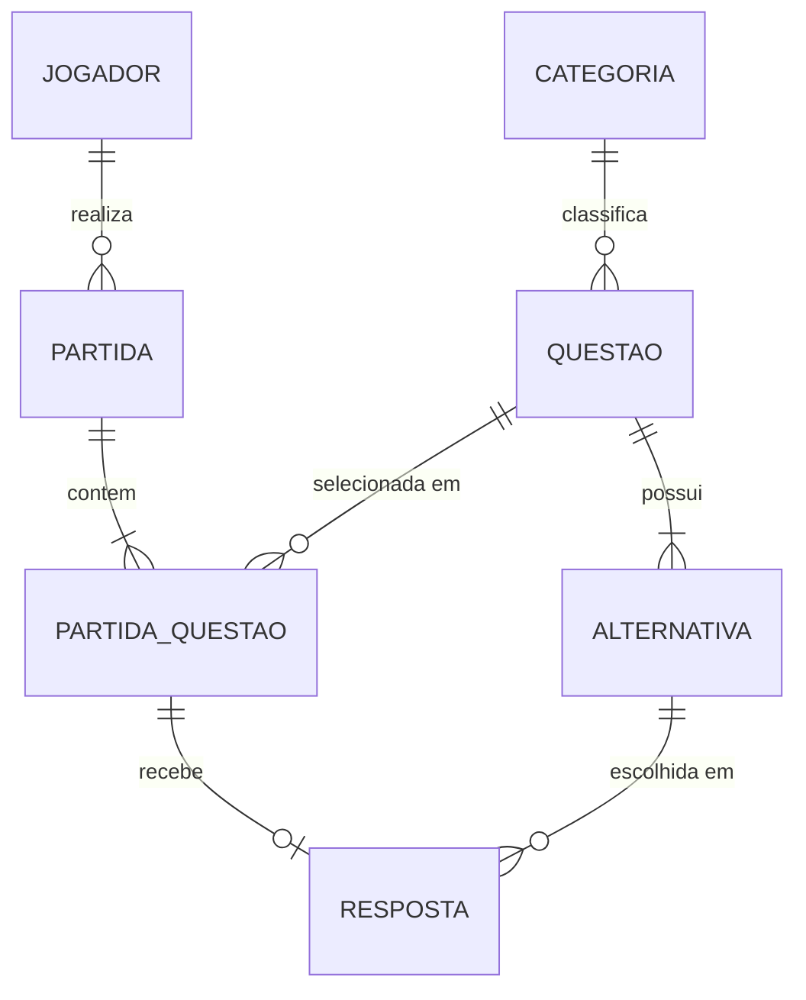

# Modelo lógico — CodeQuest

Documentação do modelo lógico relacional (diagrama feito no Visual Paradigm). O modelo tem **7 tabelas** e **7 relacionamentos**.

## 1. Visão geral

| Tabela | Papel no sistema |
| --- | --- |
| TabelaCategoria | Temas do quiz (IA, Front-End, Back-End, História, Segurança etc.) |
| TabelaJogador | Cadastro e credenciais dos jogadores |
| TabelaQuestao | Banco de questões, com explicação e URL de referência |
| TabelaAlternativa | As quatro alternativas (A a D) de cada questão |
| TabelaPartida | Partidas realizadas por um jogador |
| TabelaPartidaQuestao | Questões sorteadas para uma partida e a ordem de apresentação |
| TabelaResposta | Alternativa escolhida para cada questão da partida |

## 2. Dicionário de dados

### 2.1 TabelaCategoria

| Coluna | Chave | Descrição |
| --- | --- | --- |
| id_categoria | PK | Identificador único da categoria |
| nome | UK | Nome da categoria (não pode repetir) |
| descricao | — | Descrição do tema |

### 2.2 TabelaJogador

| Coluna | Chave | Descrição |
| --- | --- | --- |
| id_jogador | PK | Identificador único do jogador |
| nickname | UK | Nome de acesso (não pode repetir) |
| senha | — | Senha do jogador (deve guardar o hash, nunca texto puro) |
| data_cadastro | — | Data e hora do cadastro |

### 2.3 TabelaQuestao

| Coluna | Chave | Descrição |
| --- | --- | --- |
| id_questao | PK | Identificador único da questão |
| id_categoria | FK → TabelaCategoria | Categoria à qual a questão pertence |
| enunciado | — | Texto da pergunta |
| dificuldade | — | Nível de dificuldade |
| explicacao | — | Explicação exibida após a resposta |
| url_referencia | — | Link de referência externa |
| pontuacao | — | Pontos atribuídos ao acerto |

### 2.4 TabelaAlternativa

| Coluna | Chave | Descrição |
| --- | --- | --- |
| id_alternativa | PK | Identificador único da alternativa |
| id_questao | FK → TabelaQuestao | Questão a que a alternativa pertence |
| letra | — | Letra da alternativa (A, B, C ou D) |
| texto | — | Texto da alternativa |
| correta | — | Indica se é a alternativa correta |

### 2.5 TabelaPartida

| Coluna | Chave | Descrição |
| --- | --- | --- |
| id_partida | PK | Identificador único da partida |
| id_jogador | FK → TabelaJogador | Jogador que realizou a partida |
| data_inicio | — | Data e hora de início |
| data_fim | — | Data e hora de término (vazia enquanto em andamento) |
| modo_jogo | — | Modo escolhido: categoria específica ou geral |
| status | — | Estado da partida (em andamento ou concluída) |
| pontuacao_final | — | Pontuação obtida ao final das dez questões |

### 2.6 TabelaPartidaQuestao

| Coluna | Chave | Descrição |
| --- | --- | --- |
| id_partida_questao | PK | Identificador único do vínculo partida–questão |
| id_partida | FK → TabelaPartida | Partida em que a questão foi apresentada |
| id_questao | FK → TabelaQuestao | Questão sorteada |
| ordem | — | Posição da questão na partida (1 a 10) |

### 2.7 TabelaResposta

| Coluna | Chave | Descrição |
| --- | --- | --- |
| id_resposta | PK | Identificador único da resposta |
| id_partida_questao | FK → TabelaPartidaQuestao | Questão da partida que foi respondida |
| id_alternativa | FK → TabelaAlternativa | Alternativa selecionada pelo jogador |
| acerto | — | Resultado da correção (acertou ou errou) |
| data_resposta | — | Data e hora da resposta |

## 3. Relacionamentos

| Relacionamento | Tabela pai (1) | Tabela filha (N) | Cardinalidade | Significado |
| --- | --- | --- | --- | --- |
| classifica | TabelaCategoria | TabelaQuestao | 1:N | Uma categoria classifica várias questões; cada questão tem uma categoria |
| realiza | TabelaJogador | TabelaPartida | 1:N | Um jogador realiza várias partidas; cada partida é de um jogador |
| possui | TabelaQuestao | TabelaAlternativa | 1:N | Uma questão possui quatro alternativas |
| contem | TabelaPartida | TabelaPartidaQuestao | 1:N | Uma partida contém dez questões sorteadas |
| selecionada / participa | TabelaQuestao | TabelaPartidaQuestao | 1:N | Uma questão pode ser sorteada em várias partidas |
| recebe | TabelaPartidaQuestao | TabelaResposta | 1:0..1 | Cada questão da partida recebe no máximo uma resposta |
| selecionada em | TabelaAlternativa | TabelaResposta | 1:N | Uma alternativa pode ser escolhida em várias respostas |

A tabela **TabelaPartidaQuestao** resolve a relação N:N entre partidas e questões. Ela também guarda a ordem de apresentação, o que atende ao RD06.

## 4. Rastreabilidade com os requisitos

| Requisito | Onde é atendido no modelo |
| --- | --- |
| RD01, RD11 | TabelaJogador (`id_jogador`, `nickname` UK) |
| RD02 | TabelaCategoria |
| RD03 | TabelaQuestao |
| RD04, RD12 | TabelaAlternativa (`letra`, `texto`, `correta`) |
| RD05, RD13, RA12 | TabelaPartida (`data_inicio`, `data_fim`, `modo_jogo`, `status`, `pontuacao_final`) |
| RD06 | TabelaPartidaQuestao (`ordem`) |
| RD07 | TabelaResposta (`id_alternativa`, `acerto`, `data_resposta`) |
| RD08, RA06 | Chaves estrangeiras entre todas as tabelas |
| RD16 | Ranking por consulta (view) sobre `pontuacao_final`, sem tabela própria |
